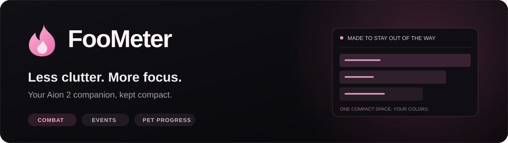
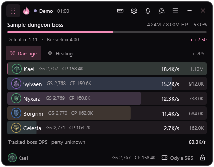
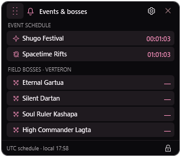
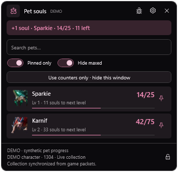

  

  <b>A compact companion for Aion 2.</b> 
  Follow your fights, keep track of events, and see your pet progress without filling the screen.

  

  Windows x64 · .NET included · Custom colors 
  <a href="#getting-started">Getting started</a> &nbsp;·&nbsp;
  <a href="https://github.com/boronadziesieciu/FooMeter/releases">Release notes</a> &nbsp;·&nbsp;
  <a href="https://github.com/boronadziesieciu/FooMeter/issues">Report a problem</a>

---

## Linux preview — CachyOS / Hyprland

An experimental Linux version based on FooMeter 0.10.29 is available to try.

**[Download the Linux x64 app (.NET included)](https://github.com/boronadziesieciu/FooMeter/raw/refs/heads/linux-preview/linux-preview/FooMeter-linux-x64-preview.tar.gz)** ·
[CachyOS setup guide](https://github.com/boronadziesieciu/FooMeter/blob/linux-preview/linux-preview/README-LINUX.md) ·
[Source and preview details](https://github.com/boronadziesieciu/FooMeter/tree/linux-preview/linux-preview)

Includes combat, skills, timers, pet progress and history. Uses XWayland and the
Linux `dumpcap` helper. Loot-row OCR, click-through and global hotkeys are not yet
ported. Core and X11 smoke tests pass; live game capture and Hyprland behavior
still need testing on your machine. Read the setup guide before capturing.

## Your fight, at a glance

  

**Everything in one small row:** class icon, name, Gear Score, Combat Power and damage.
Track your own performance or confirmed party members against bosses and training dummies.

| Combat clarity | Made for your screen | Keep what matters |
| :--- | :--- | :--- |
| DPS and healing views | Compact bars and a one-line combat strip | Fight history survives restarts |
| Automatic GS / CP when observed | Your accent, background and flame colors | Player and skill breakdowns |
| Party DPS and boss estimates | Independent scale and opacity controls | Encounter comparison and exports |
| Clear capture-status indicators | Click-through lock; hold **Alt** to interact | Settings carry across versions |

   
  Want even less on screen? Switch to the one-line combat strip.

## Small extras. Separate overlays.

<table>
<tr>
<td width="50%" valign="top">
<h3>Events &amp; bosses</h3>

Shugo Festival, Spacetime Rifts and four major field bosses in a slim timer panel. Show only the timers you need, with separate sizing and transparency.

</td>
<td width="50%" valign="top">
<h3>Pet progress</h3>

Pet portraits, soul totals and progress to the next level. Pin your farming list, hide maxed pets, or hide the whole window and keep progress beside visible soul-loot rows.

</td>
</tr>
</table>

Combat and pet previews use labeled demo data. Unknown game values stay unknown in the app; screenshots are not a claim of live performance.

## Getting started

1. **Download** the latest **FooMeter-Setup-…-win-x64.exe** from [Releases](https://github.com/boronadziesieciu/FooMeter/releases/latest).
2. **Install [Npcap](https://npcap.com/#download)** separately for live packet capture. The FooMeter installer already includes .NET.
3. **Close any older FooMeter copy**, run Setup, then launch FooMeter from the Start menu. Allow the normal Windows administrator prompt.
4. **Open the gear button** to choose your colors and overlays. Capture starts automatically when enabled. Start capture before entering your character for the best chance of receiving a complete snapshot.

**Moving a window:** use the dotted grip in its header. **Locked window:** hold Alt to interact temporarily.

## Updates that fit around your fight

From **0.10.31**, FooMeter checks at startup and every two hours. When a new release is available, choose **Update now** to download, verify, install and restart. Automatic prompts wait until your current fight ends.

Required releases show **Update required** and pause capture after combat until you update or exit. Settings → General also offers a manual check. Settings, history and saved pet progress stay in place.

**Using an older version?** Install 0.10.31 once to enable future update checks.

<b>Requirements, data &amp; troubleshooting</b>

- Windows x64 and Npcap are required. Npcap is not bundled.
- Game patches or missing packets can affect recognition. GS/CP, collection totals and boss information appear when the necessary data is available.
- Healing includes observed effective-heal estimates; boss defeat times are estimates based on measured damage.
- Loot-row counters use local screen recognition to locate visible items. Collection totals come from game data; OCR does not invent totals.
- Settings and history remain in the existing <code>%LOCALAPPDATA%\AscendAPP</code> folder across FooMeter versions.
- Update notices are signed and installer size/SHA-256 are checked before launch. This is separate from Windows code signing, so Windows may display an unknown-publisher warning.
- An offline or failed update check does not introduce a new update requirement.
- If something looks wrong, include your FooMeter version, the relevant capture-status message and steps to reproduce it in an issue. Do not post account credentials or raw private captures.

---

  <b>FooMeter</b> · Less clutter. More focus. 
  An independent community project, not affiliated with NCSOFT. Game names and class/pet artwork belong to their respective owners. 
  Third-party notices are included with the app. This repository hosts release downloads and the feature page.

