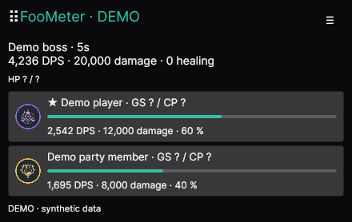
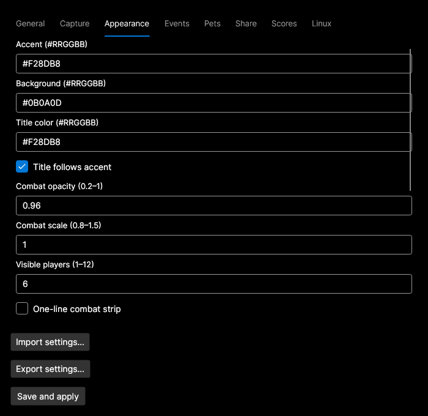
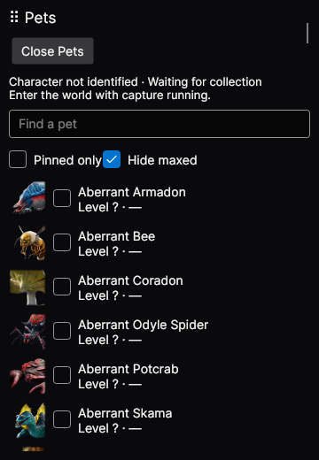
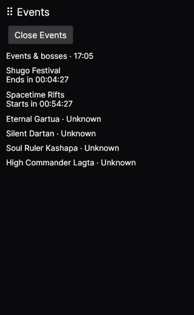
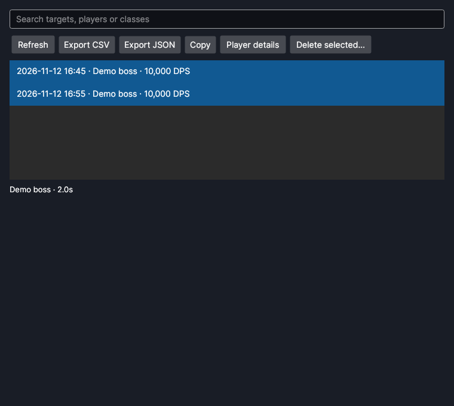
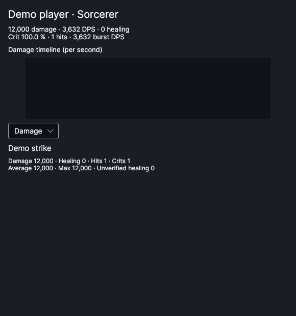

# FooMeter Linux · expanded interface

**[Download the updated Linux x64 app](https://github.com/boronadziesieciu/FooMeter/raw/refs/heads/linux-preview/linux-preview/FooMeter-linux-x64-preview.tar.gz)** ·
**[CachyOS setup and controls](README-LINUX.md)** ·
[Source ZIP](https://github.com/boronadziesieciu/FooMeter/raw/refs/heads/linux-preview/linux-preview/FooMeter-linux-preview-source.zip) ·
[Browse/build the source](source/) · [Checksums](SHA256SUMS.txt)

Close the older copy, extract the updated archive into a fresh folder, and run
`./run-foometer.sh`. Your Linux settings, pets and history remain in the same
user profile. .NET is included. Use `--demo` to explore without live capture.

This update rebuilds the interface around the original FooMeter 0.10.29 core:

- Compact combat overlay with class icons, damage/healing views, strip mode,
  colors, scaling, opacity, position locking, observed GS/CP and boss forecasts.
- Persistent settings: General, Capture, Appearance, Events, Pets, Share, Scores
  and Linux integration, including import/export.
- Capture adapter/port controls and automatic restart with the saved adapter.
- Complete skill breakdowns with sorting and a damage timeline.
- Searchable fight history with comparison, JSON/CSV exports, deletion and chat copy.
- Separate event and pet windows with independent appearance and positions,
  all 207 pet portraits, pins, filters and soul pickup cards.
- Tray controls, timer notifications, local reminders and Hyprland command bindings.
- X11 click-through with Alt interaction and an independent recovery command.
- Optional grim/slurp/Tesseract loot-row recognition and transparent counters.

See the guide for dependencies, optional screenshot tools, command bindings and
limitations. Live game behavior, Hyprland stacking, native Wayland Alt handling,
tray/notification hosting and screencopy still need desktop testing. This is an
experimental Linux rebuild, not a claim of full compatibility with every game
patch or compositor configuration. The Windows installer/updater is replaced by
Linux package downloads.

Validation includes all 555 core checks, Linux persistence/export/OCR checks,
real Tesseract recognition on synthetic text, real dumpcap enumeration/error
handling, and X11 UI tests for every settings tab, settings edits, history
comparison, IPC and click-through restoration.

The screenshots use synthetic combat and unknown pet totals, not live game data.

The original minimal preview remains available from [its historical commit](https://github.com/boronadziesieciu/FooMeter/tree/c01f518603ed09e3773f99cedcca3f12ce62dcbf/linux-preview).
